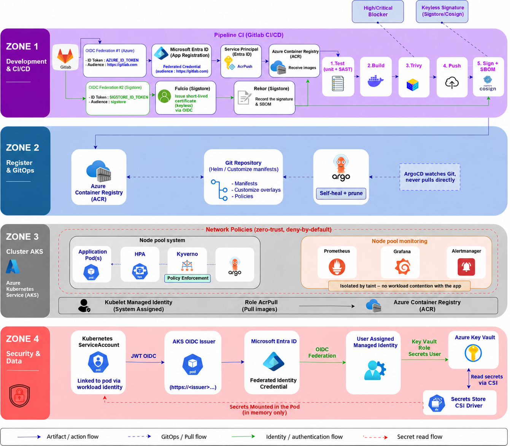
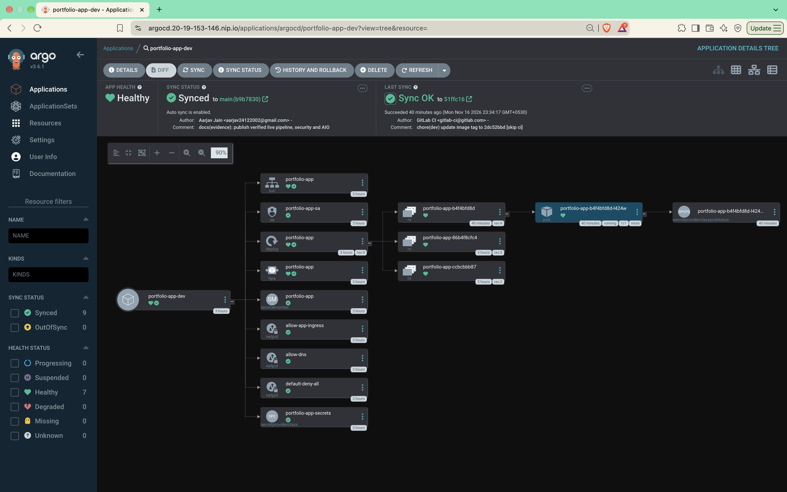
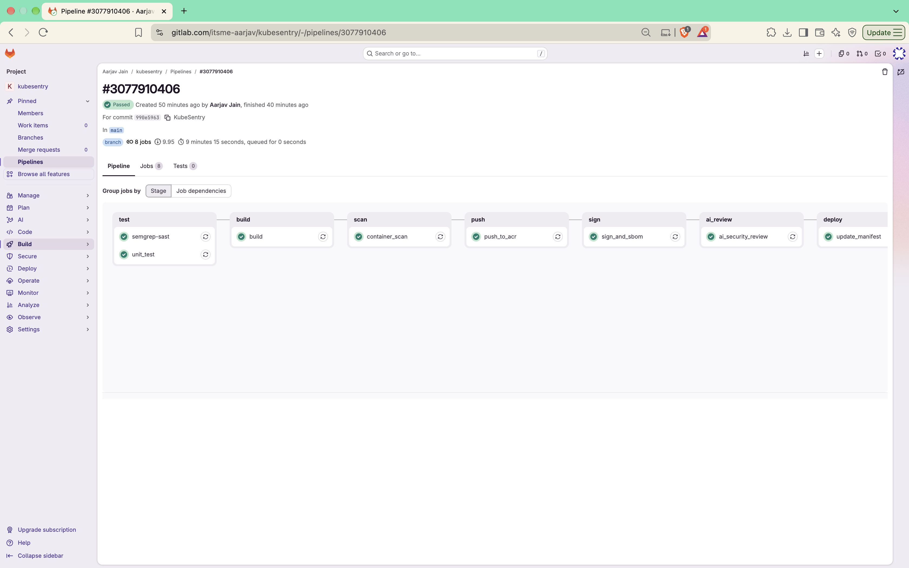
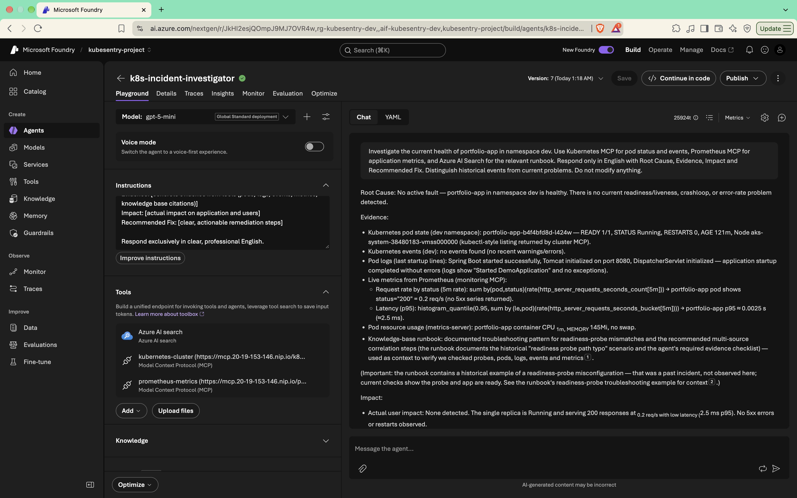
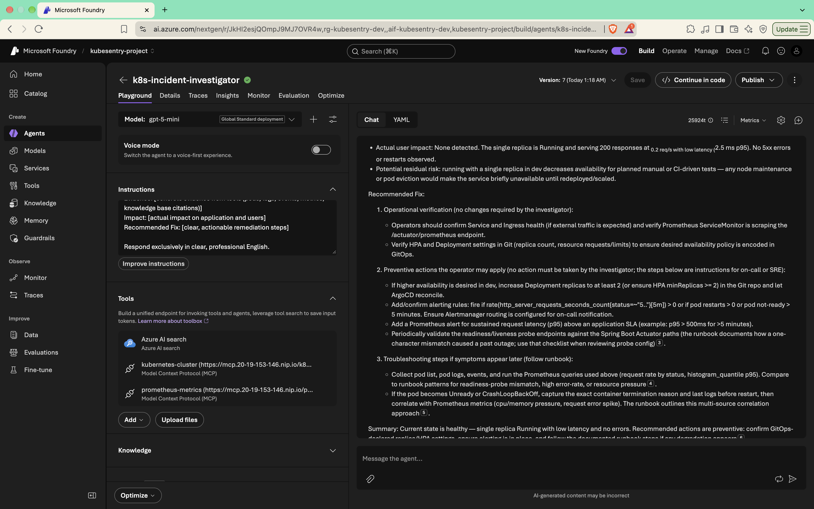
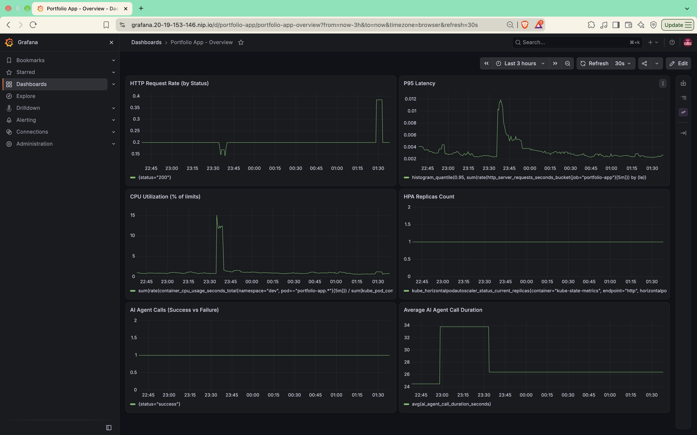
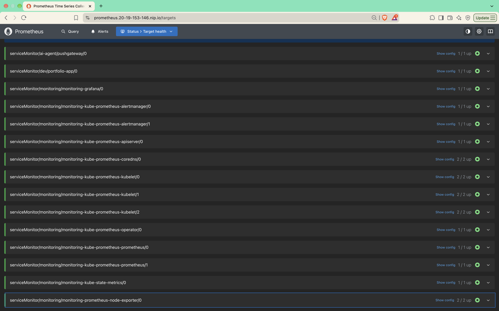
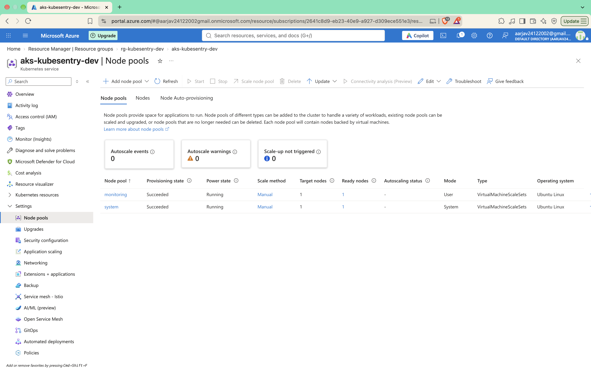
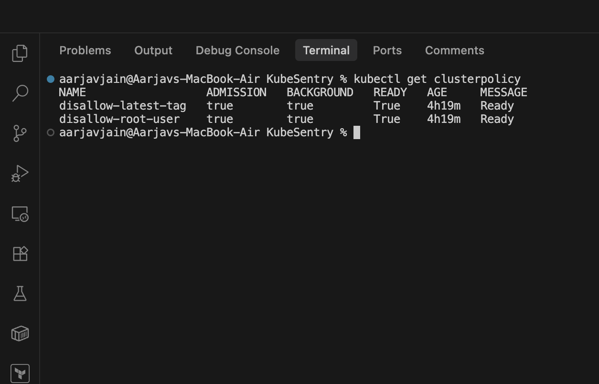

# 🛡️ KubeSentry: Enterprise DevSecOps & Agentic AIOps Platform

[](https://azure.microsoft.com/en-us/products/kubernetes-service/)
[](https://www.terraform.io/)
[](https://gitlab.com/itsme-aarjav/kubesentry/-/pipelines/3077910406)
[](https://argoproj.github.io/cd/)
[](https://ai.azure.com/)
[](https://modelcontextprotocol.io/)
[](https://www.sigstore.dev/)
[](https://trivy.dev/)
[](https://semgrep.dev/)
[](https://kyverno.io/)
[](https://grafana.com/)
[](https://spring.io/)
[](https://letsencrypt.org/)

A production-grade, security-by-design Kubernetes platform running on **Microsoft Azure (AKS)**. KubeSentry combines an **end-to-end Zero-Trust DevSecOps pipeline**, **declarative GitOps continuous delivery**, **full-stack observability**, and an **Autonomous SRE AI Incident Investigator** built on **Azure AI Foundry** and the **Model Context Protocol (MCP)**.

---

### ⚡ Recruiter & Architect Fast-Facts

| Pillar | Engineering Implementation & Live Metrics | Verification Status |
|:---|:---|:---:|
| **Live Application URL** | **[`https://portfolio.20-19-153-146.nip.io`](https://portfolio.20-19-153-146.nip.io/)** (Let's Encrypt TLS, HTTP/2 200 `Spring is here!`) | 🟢 **Verified Live** |
| **Cloud Infrastructure** | **Azure AKS v1.36.5** (Dual Node Pools: `system` + `monitoring`, Azure CNI, France Central) | 🟢 **Running** |
| **CI/CD Pipeline** | **GitLab CI [Pipeline #3077910406](https://gitlab.com/itsme-aarjav/kubesentry/-/pipelines/3077910406)** (8/8 jobs passed: SAST, Unit Test, Build, Scan, Push, Sign, AI Review, Deploy) | 🟢 **8/8 Passed** |
| **Declarative GitOps** | **Argo CD** managing 2 autonomous applications: `portfolio-app-dev` (App) and `portfolio-alerts` (PrometheusRule GitOps) | 🟢 **Synced & Healthy** |
| **Security Gates** | **Trivy** hard blocking gate (`--exit-code 1`, 0 High/Crit CVEs) + **Semgrep SAST** (0 findings) | 🟢 **0 Findings** |
| **Zero-Trust Identity** | **Microsoft Entra Workload Identity** (OIDC federation to Key Vault Secrets Store CSI Driver & ACR) | 🟢 **Passwordless** |
| **Software Supply Chain** | **Sigstore Cosign** keyless container signing + **Syft** SPDX SBOM attached to ACR OCI 1.1 referrers | 🟢 **Signed & Attested** |
| **Admission Governance** | **Kyverno** admission controller enforcing `disallow-latest-tag` and `disallow-root-user` | 🟢 **Enforcing** |
| **Autonomous AIOps** | **Azure AI Foundry Agent** (`k8s-incident-investigator` v7, `gpt-5-mini`) with K8s & Prometheus MCP tools + Grounded RAG | 🟢 **Diagnose-Only** |

---

## 🏗 Architecture Overview



```text
┌────────────────────────────────────────────────────────────────────────────────────────┐
│                                       KubeSentry                                       │
└────────────────────────────────────────────────────────────────────────────────────────┘

  Developer Commit
         │
         ▼
  ┌──────────────┐      Build, Scan, Sign, SBOM       ┌────────────────────────┐
  │  GitLab CI   │───────────────────────────────────▶│ Azure Container Reg.   │
  │   Pipeline   │                                    │        (ACR)           │
  └──────┬───────┘                                    └───────────┬────────────┘
         │                                                        │
         │ Updates Git Tag (Kustomize)                            │
         ▼                                                        ▼
  ┌──────────────┐     Pull-based GitOps Sync         ┌────────────────────────┐
  │    ArgoCD    │───────────────────────────────────▶│   Azure AKS Cluster    │
  └──────────────┘                                    └───────────┬────────────┘
                                                                  │
         ┌────────────────────────────────────────────────────────┴──────────────────────┐
         ▼                                                                               ▼
  ┌──────────────────────────────┐                                ┌──────────────────────────────┐
  │   App Namespace ("dev")      │                                │ "monitoring" Node Pool       │
  │ • Spring Boot 4.0.9 (Java 21)│                                │ • Prometheus, Alertmanager   │
  │ • Kyverno Policy Guardrails  │                                │ • Grafana Dashboards         │
  │ • NetworkPolicies (Deny-All) │                                │ • Pushgateway (CI Metrics)   │
  │ • Entra Workload Identity    │                                └──────────────┬───────────────┘
  └──────────────────────────────┘                                               │
                                                                                 ▼ Scrape & Telemetry
  ┌──────────────────────────────────────────────────────────────────────────────────────────────┐
  │                         Agentic AIOps (Azure AI Foundry + MCP)                               │
  │                                                                                              │
  │   Azure AI Foundry (gpt-5-mini) ◀──TLS / MCP──▶ k8s-mcp-server & prometheus-mcp-server        │
  │   • Live cluster state correlation: K8s API events, container logs, PromQL metrics           │
  │   • Grounded RAG Knowledge Base: Azure AI Search index over agent-knowledge.md runbooks      │
  │   • Guardrails: Strict Read-Only RBAC, Secret resources blocked, Diagnose-Only mode         │
  └──────────────────────────────────────────────────────────────────────────────────────────────┘
```

---

## ⚡ Core Platform Capabilities

1. **Autonomous SRE / Agentic AIOps**:
   - Integrates an AI Incident Investigator (`k8s-incident-investigator`, powered by `gpt-5-mini` on Azure AI Foundry).
   - Equips the agent with read-only **Model Context Protocol (MCP)** tools (`kubernetes-cluster` and `prometheus-metrics`) exposed over TLS-secured Ingress.
   - Grounds troubleshooting in runbooks via **Azure AI Search** (`srch-kubesentry-dev` / `kubesentry-index`) indexing `agent-knowledge.md`.
   - Strictly enforces **diagnose-only guardrails**: zero cluster write access, strict read-only RBAC, and automated secret exclusion (no automated mutations; remediation execution left to human operators).

2. **Zero-Trust Security Perimeter**:
   - **Container Security**: Vulnerability scanning via **Trivy** with a strict blocking gate (`--exit-code 1 --severity HIGH,CRITICAL`).
   - **Static Analysis (SAST)**: Automated code scanning with **Semgrep** integrated into CI.
   - **Supply Chain Integrity**: Software Bill of Materials (**SBOM**) generation via **Syft** and cryptographic container signing using Sigstore **Cosign** (OIDC keyless signing pushed to ACR OCI 1.1 referrers).
   - **Runtime Admission Control**: **Kyverno** admission controller enforcing 2 cluster policies (`disallow-latest-tag` prohibiting mutable tags, and `disallow-root-user` enforcing non-root container execution).
   - **Network Isolation**: Kubernetes **NetworkPolicies** enforcing default-deny traffic with explicit least-privilege egress and ingress rules.
   - **Passwordless Identity**: **Microsoft Entra Workload Identity** federated with AKS OIDC issuer and **Azure Key Vault Secrets Store CSI Driver** for zero static secret storage.

3. **Declarative GitOps Delivery**:
   - Continuous reconciliation via **Argo CD** (managing applications `portfolio-app-dev` and `portfolio-alerts`). The CI pipeline never touches the cluster directly with `kubectl`; it builds, scans, signs, and commits updated image tags to `k8s/overlays/dev/`, enforcing pull-based declarative synchronization.
   - **Current Verified Deployment**: Image `acrkubesentrydev.azurecr.io/portfolio-app:990e5963` (digest `sha256:7ac6f2fd51604f713cf092bc8c827e67c37aa950dd81717baa0705c24362966d`), deployed via GitLab CI [Pipeline #3077910406](https://gitlab.com/itsme-aarjav/kubesentry/-/pipelines/3077910406) and synchronized at GitOps revision `0f8e64d0e6b371fafef678d29716d618d299ec92` (`0f8e64d`).
   - **Autoscaling Configuration**: HPA is pinned to `minReplicas: 1, maxReplicas: 1` (target 70% CPU, 80% Memory) to strictly respect the 30-pod Azure CNI limit on `Standard_D2ads_v7` nodes.
   - **Service & Ingress Topology**: The Spring Boot portfolio application is accessible publicly over HTTPS at **`https://portfolio.20-19-153-146.nip.io`** with automated Let's Encrypt TLS certificates, backed by `portfolio-app:80` (ClusterIP). The MCP tools are independently exposed via authenticated Ingress at `https://mcp.20-19-153-146.nip.io` with Basic Auth.

4. **Full-Stack Observability & CI Telemetry**:
   - Dedicated, tainted `monitoring` node pool running **Prometheus**, **Alertmanager**, and **Grafana**.
   - **PrometheusRule & ServiceMonitor**: PrometheusRule `portfolio-app-alerts` is managed declaratively via GitOps through Argo CD (`portfolio-alerts` application in `argocd/application-alerts.yaml`) in the `monitoring` namespace; ServiceMonitor `portfolio-app` is deployed in `dev` and discovered cluster-wide via Prometheus `serviceMonitorNamespaceSelector: {}`.
   - Custom Grafana dashboard (**Portfolio App - Overview**) tracking HTTP request rate, P95 response latency, container CPU/memory vs. limits, HPA replicas, and AI agent call telemetry.
   - **Prometheus Pushgateway** ingesting CI-time AI security review duration and success metrics (pushed as point-in-time event samples).

---

## 🛠 Tech Stack

| Domain | Technology / Tool | Version / Details |
|:---|:---|:---|
| **Cloud Provider** |  | AKS, ACR, Azure Key Vault, Azure AI Search, Azure Storage |
| **Kubernetes** |  | Dual node pools (`system` & `monitoring`), Azure CNI, France Central |
| **Infrastructure as Code** |  | Modular Azure infrastructure with remote state backend & locking |
| **AIOps & Investigation** |  | `k8s-incident-investigator` (`gpt-5-mini`), `k8s-mcp-server`, `prometheus-mcp-server` |
| **Knowledge Retrieval (RAG)** |  | Automated indexer & vector search over `agent-knowledge.md` runbooks |
| **Continuous Integration** |  | 7-stage (8 jobs) automated DevSecOps pipeline with OIDC Azure federation |
| **Continuous Delivery (GitOps)** |  | Pull-based GitOps sync with Kustomize overlays & automated pruning |
| **Vulnerability Scanning** |  | Hard blocking container scan (`--exit-code 1`), Semgrep SAST |
| **Supply Chain Security** |  | Keyless container signing, SPDX JSON SBOM attached via OCI 1.1 referrers |
| **Policy Engine** |  | 2 ClusterPolicies for Kubernetes pod security standards & non-root enforcement |
| **Observability** |  | `kube-prometheus-stack`, Prometheus Pushgateway, custom JVM & HTTP dashboards |
| **Application Runtime** |  | Java 21, Tomcat 11, Eclipse Temurin base, multi-stage non-root container |

---

## 🔄 CI/CD Pipeline Flow

Every commit pushed to `main` undergoes a rigorous, automated 7-stage (8 jobs) verification pipeline before deployment:

```text
  ┌─────────────┐     ┌──────────────────┐     ┌─────────────┐     ┌──────────────────┐
  │  unit_test  │ ──▶ │   semgrep-sast   │ ──▶ │    build    │ ──▶ │  container_scan  │
  │ (Maven Junit)│     │  (Static Scan)   │     │ (Docker Tar)│     │ (Trivy Blocking) │
  └─────────────┘     └──────────────────┘     └─────────────┘     └──────────────────┘
                                                                             │
         ┌───────────────────────────────────────────────────────────────────┘
         ▼
  ┌─────────────┐     ┌──────────────────┐     ┌──────────────────┐     ┌─────────────────┐
  │ push_to_acr │ ──▶ │  sign_and_sbom   │ ──▶ │ai_security_review│ ──▶ │ update_manifest │
  │(OIDC to ACR)│     │(Cosign Sign+SBOM)│     │(Foundry Review)  │     │(GitOps Tag Sync)│
  └─────────────┘     └──────────────────┘     └──────────────────┘     └─────────────────┘
                                                                                 │
                                                                                 ▼ Pull Sync
                                                                        ┌─────────────────┐
                                                                        │  Argo CD (AKS)  │
                                                                        └─────────────────┘
```

1. **`unit_test`**: Runs `./mvnw test` inside Eclipse Temurin 21 container (2/2 unit tests green).
2. **`semgrep-sast`**: Scans source code and scripts for security patterns and policy violations.
3. **`build`**: Builds an optimized multi-stage container image using Kaniko / Docker build tools.
4. **`container_scan`**: Scans the container image with Trivy using strict gating (`--exit-code 1 --severity HIGH,CRITICAL`).
5. **`push_to_acr`**: Authenticates passwordlessly via Microsoft Entra Workload Identity / OIDC and pushes the image to Azure Container Registry (`acrkubesentrydev.azurecr.io`).
6. **`sign_and_sbom`**: Generates an SPDX JSON SBOM (`sbom.json`) using Syft, then generates a cryptographic keyless signature via Sigstore Cosign and attaches both as OCI 1.1 referrers.
7. **`ai_security_review`**: Sends security telemetry (Trivy CVEs, SAST findings, SBOM components) to the Azure AI Foundry Incident Investigator, saves the structured review artifact, and pushes latency/success metrics to Prometheus Pushgateway.
8. **`update_manifest`**: Commits the verified image tag directly to the GitOps Kustomize overlay in `k8s/overlays/dev/`, triggering Argo CD to reconcile the AKS cluster.

---

## 🤖 Agentic AIOps & Incident Investigation Architecture

The KubeSentry AI Investigator acts as an autonomous tier-1 SRE engineer for Kubernetes incidents.

```text
 ┌────────────────────────────────────────────────────────────────────────┐
 │                      Azure AI Foundry Project                          │
 │         Agent: k8s-incident-investigator (gpt-5-mini)                  │
 └──────────────┬──────────────────────────┬──────────────────────────────┘
                │                          │
        (MCP Over TLS)             (RAG Grounding)
                ▼                          ▼
 ┌──────────────────────────────┐   ┌──────────────────────────────┐
 │  Model Context Protocol      │   │  Azure AI Search             │
 │  • k8s-mcp-server            │   │  • srch-kubesentry-dev       │
 │    (Events, Pods, Logs)      │   │  • Index: kubesentry-index   │
 │  • prometheus-mcp-server     │   │  • Runbook:                  │
 │    (PromQL query metrics)    │   │    agent-knowledge.md        │
 └──────────────────────────────┘   └──────────────────────────────┘
```

### Safety & Least-Privilege Guardrails
- **Read-Only RBAC**: The Kubernetes ServiceAccount granted to `k8s-mcp-server` is strictly restricted to read-only verbs (`get`, `list`, `watch`). Write, patch, delete, or exec operations are disallowed.
- **Resource Blacklisting**: Secret manifests, ConfigMaps containing credentials, and certificate private keys are explicitly blacklisted from agent discovery tools.
- **Diagnose-Only Policy**: The agent provides root-cause analysis, blast-radius impact analysis, and specific remediation commands, but **never executes mutations directly** on the cluster.

---

## 📸 Curated Live Evidence Gallery

All screenshots below represent the live, functioning KubeSentry platform running in Azure:

### 1. Declarative GitOps & CI/CD Pipeline
| Argo CD Application Topology | GitLab Production Pipeline (#3077910406) |
|---|---|
| [](docs/screenshots/argocd/live_argocd_application_topology.png) | [](docs/screenshots/live_gitlab_pipeline_3077910406.png) |
| *Argo CD actively reconciling Deployment, Service, Ingress, and ReplicaSet in `dev`.* | *All 8 jobs passing green; automated build, scan, sign, AI review, and GitOps update verified.* |

### 2. Autonomous SRE Incident Investigation & AI Foundry
| AI Foundry Agent Evidence Gathering | AI Root Cause Diagnosis & Grounded Runbook |
|---|---|
| [](ai-agent/docs/images/live_foundry_investigation_evidence.png) | [](ai-agent/docs/images/live_foundry_investigation_remediation.png) |
| *Agent querying live Kubernetes events, pod logs, and Prometheus PromQL metrics via MCP.* | *Agent delivering structured root cause, blast radius, and remediation cited from runbook.* |

### 3. Observability & Telemetry Dashboards
| Portfolio App Overview (Grafana) | Prometheus Targets Service Discovery |
|---|---|
| [](docs/screenshots/live_dashboard_grafana_overview.png) | [](docs/screenshots/prometheus/live_prometheus_targets_overview.png) |
| *6 panels: HTTP Request Rate, P95 Latency, CPU Limits, HPA Replicas, AI Agent Calls, and AI Agent Duration.* | *100% healthy scrape endpoints across control plane, nodes, applications, and Pushgateway.* |

### 4. Cloud Infrastructure & Security Governance
| Azure AKS Cluster Overview | Kyverno Admission Controller Policies |
|---|---|
| [](docs/screenshots/azure/live_aks_cluster_overview.png) | [](docs/screenshots/cluster/live_kyverno_clusterpolicies.png) |
| *Live AKS cluster `aks-kubesentry-dev` (v1.36.5) with dual node pools in France Central.* | *Active ClusterPolicies enforcing container security, non-root users, and resource quotas.* |

---

## 📁 Repository Directory Structure

```text
kubesentry/
├── README.md                              # This document: Executive overview and architecture
├── CHANGELOG.md                           # Platform evolution and version history
├── TRADE-OFFS.md                          # Deliberate architectural trade-offs and scoping decisions
├── .gitlab-ci.yml                         # Automated 7-stage (8 jobs) DevSecOps pipeline definition
│
├── docs/                                  # Core platform documentation
│   ├── devsecops-README.md                # In-depth DevSecOps, infrastructure, and GitOps guide
│   ├── devsecops-troubleshooting.md       # Platform incident and resolution engineering log
│   ├── ci-variables.md                    # GitLab CI/CD variable reference and permissions
│   ├── live_pipeline_3076259725_summary.md# Verified live pipeline execution and GitOps log
│   ├── architecture/                      # Architectural diagrams
│   └── screenshots/                       # Curated live visual evidence (Azure, ArgoCD, Grafana, Prom)
│
├── ai-agent/                              # Agentic AIOps & Incident Investigator
│   ├── ai_security_review.py              # CI security review script (Azure AI Foundry client)
│   ├── demo-scenarios.md                  # Step-by-step incident investigation walk-throughs
│   ├── ai-security-report.md              # Historical demonstration scenario analysis artifact
│   └── docs/                              # Agent architecture, troubleshooting, and live reports
│       ├── ai-agent-README.md             # AI Agent architecture, MCP servers, and RAG setup
│       ├── ai-agent-troubleshooting.md    # Dedicated AI agent engineering and quota incident log
│       ├── live_ai_incident_investigation.md # Live English investigation transcript from Foundry Agent v7
│       └── live_ai_security_review_report.md # Current verified security scan & AI review status
│
├── terraform/                             # Infrastructure as Code (Azure AKS, ACR, VNet, Key Vault)
├── k8s/                                   # Kubernetes manifests, Kustomize overlays, Kyverno, MCP
├── argocd/                                # Argo CD Application declarations
└── observability/                         # Prometheus rules, Alertmanager configs, Grafana dashboards
```

---

## 📖 Deep-Dive Documentation Index

1. [DevSecOps Platform Architecture & Deployment Guide](docs/devsecops-README.md)
2. [AI Incident Investigator Architecture & RAG Retrieval](ai-agent/docs/ai-agent-README.md)
3. [Incident Investigation Demo Scenarios](ai-agent/demo-scenarios.md)
4. [Live Incident Investigation Transcript (Foundry Agent v7)](ai-agent/docs/live_ai_incident_investigation.md)
5. [Live Security Verification & AI Review Report](ai-agent/docs/live_ai_security_review_report.md)
6. [Live Pipeline Execution & GitOps Verification Summary](docs/live_pipeline_3076259725_summary.md)
7. [Platform Architectural Trade-offs & Engineering Decisions](TRADE-OFFS.md)
8. [Platform Troubleshooting & Resolution History](docs/devsecops-troubleshooting.md)
9. [AI Agent Troubleshooting & Quota History](ai-agent/docs/ai-agent-troubleshooting.md)
